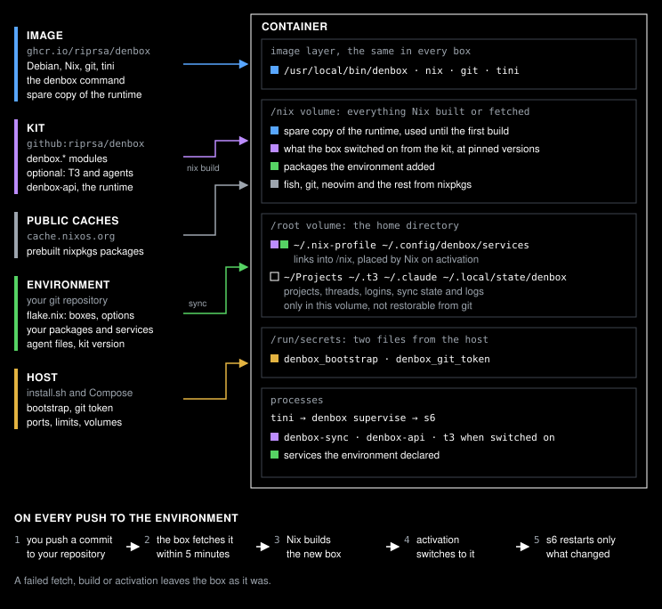

# denbox

A box is a Linux workspace built from a flake: shell and tools, optionally T3
Code and coding agents, as Home Manager modules. The box follows a Git
repository you own, the environment, and applies every new commit on its own.
A box runs as a Docker container or straight on a Linux machine with systemd.



- `kit/`: the Home Manager modules, `denbox-api`, the `denbox` runtime.
- `image/`: the container image, with Nix and a seed of the runtime.
- `template/`: an environment to start from.
- `extension/`: a browser extension that shows the box's state and runs
  browser parts from Git sources.

## Quick start

1. **An environment.** Copy `template/` into a new Git repository (or run
   `nix flake init -t github:riprsa/denbox` in one), edit `flake.nix` and push.
   See [template/README.md](template/README.md).
2. **A box.** On a host with Docker and Compose, or Podman with a user
   systemd, run

   ```sh
   bash install.sh
   ```

   It asks for the repository URL, the branch, the box name and, for a
   private repository, a token that can read it. It reads what the box asks
   of its host from the environment, shows it and asks before it starts
   anything, then asks for each secret the box declares. It writes the
   installation to `./denbox-<box>` and starts the box. The first build takes
   a while; follow it with `cd denbox-<box> && docker compose logs -f box`.
   Run the installer again with the same `--dir` to update the image; it asks
   again only when the request changed. `bash install.sh --help` and the top
   of the script list the options for unattended use, `--accept` among them.
3. **The extension.** Load `extension/` unpacked and set its box address to
   the box's API, `http://127.0.0.1:48099` on the Docker host. The box only
   supplies data; code the extension runs comes from sources on a protected
   Git branch. See [extension/README.md](extension/README.md).

T3 Code listens on `127.0.0.1:3773` of the host.

The kit's own packages come prebuilt from the binary cache
`https://denbox.cachix.org`; everything else comes from `cache.nixos.org` or
its vendor. Set `DENBOX_BINARY_CACHE=0` in the box's environment to build them
locally instead. See [Binary cache](docs/design.md#binary-cache).

## Approving a change

By default a box applies every new commit of its environment on its own. With
`denbox.apply = "approve"` it builds the commit and waits: `denbox pending`
shows the revision and what changes in the box, `denbox apply` activates it.
The revision that turns this off waits for approval too. See
[Sync](docs/design.md#sync).

## What a box asks of its host

Ports, limits, the size of `/tmp` and `/dev/shm`, devices, capabilities,
host paths and secrets the host provides are options of the box too, under
`denbox.host`, so the environment's repository describes everything.
`install.sh` reads them from there. `deploy/render` turns them into a Compose
file or Podman Quadlet units, and explains in words what the box asks for,
what weakens its isolation first:

```sh
nix eval --json .#boxes.main.host > host.json
deploy/render --explain --name main host.json
deploy/render --format quadlet --name main --image ghcr.io/riprsa/denbox:latest \
  --bootstrap ./bootstrap.json --token ./git_token --output ~/.config/containers/systemd host.json
```

See [docs/design.md](docs/design.md), What a box asks of its host.

## On a machine, without a container

On a Linux machine with systemd (Debian, Ubuntu, Arch Linux, SteamOS), as
root, run

```sh
bash install-host.sh
```

It asks the same questions as `install.sh`, installs Nix with its daemon when
it is missing, and runs the box as the user the box names in
`home.username` and `home.homeDirectory`, creating that user when needed. A
Nix already installed with its daemon is used as it is. The box becomes the
unit `denbox-<box>.service`: `journalctl -u denbox-<box> -f` for its logs,
`su - <user> -c 'denbox shell'` for its shell. Run it again with
`--name <box>` to update. The box manages that user's home and services; it
does not manage the machine (kernel, firewall, system packages) and is not
isolated from it.

To run another box of the same environment on the machine, run it again
with the box: `--name <box> --box <other>`; `--repository` and `--ref` change
the environment the same way. The other box must name the same user; a box
of another user is a second installation, with another `--name`.

On a Steam Deck, install multi-user Nix first with an installer that supports
SteamOS, and give the box `home.username = "deck"` and
`home.homeDirectory = "/home/deck"`.

## A box in a tailnet

By default a box shares its host's place in the network: it is reached
through ports the host publishes, and whatever it sends leaves as the host,
so an agent in the box reaches everything the host reaches. With
`denbox.tailscale.enable` the box is a Tailscale node of its own, with its own
name, address and entry in the tailnet's access rules, and
`denbox.tailscale.serve` publishes its ports to the tailnet with the
tailnet's certificate instead of through the host.

- **The host** grants the tunnel device and the key. The module asks for
  both in `denbox.host`, so `install.sh` shows the device and the
  `NET_ADMIN` capability in the request and asks for the auth key without
  echo (or reads `--secret-file tailscale_authkey=FILE`). The key is used
  once, at the first start; leave it empty to run `tailscale login` in the
  box instead. A host that grants no device runs the box with
  `denbox.tailscale.userspace = true`, which asks for the key only.
- **Tag the node and restrict it.** Ask for a tag such as `tag:denbox` in
  `denbox.tailscale.tags`, create the key for that tag, and give the tag
  only the access a box needs in the tailnet's rules. A box in a tailnet
  without rules for it reaches the whole tailnet, which only moves the
  problem.

See the commented example in [template/flake.nix](template/flake.nix) and
the section Tailscale of [docs/design.md](docs/design.md).

## More

- [docs/design.md](docs/design.md): the contracts between the parts, every
  option.
- [extension/README.md](extension/README.md), [template/README.md](template/README.md).
